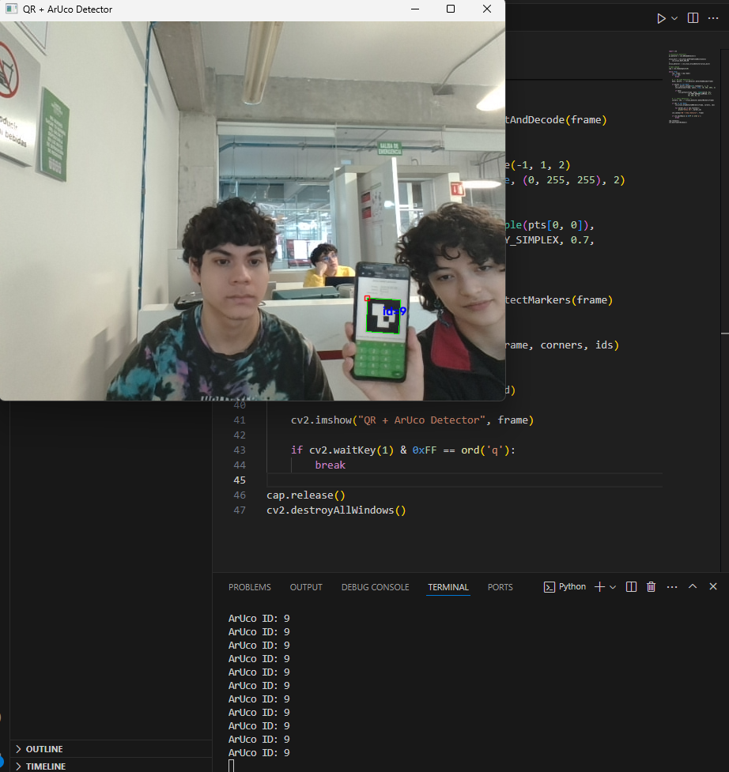

# Bitácora Universitaria: Ingeniería Mecatrónica

## Sesión 7: Control PID 

| Campo | Detalle |
| :--- | :--- |
| **Fecha** | 30 de noviembre del 2026 |
| **Autora** | Carmen Leyva López |
| **Asignatura** | Introducción a la mecatrónica |

### ¿Qué es controlar?

En el contexto de la mecatrónica, **controlar** implica lograr que un sistema se comporte según lo deseado, manteniéndose estable incluso frente a cambios o perturbaciones externas.

El concepto fundamental se basa en:

> **Controlador** = La lógica que determina cuánto actuar en función del error.
>
> **Error** = (lo que quiero) − (lo que tengo).

### El controlador PID: P, I y D

El término PID proviene de las siglas de sus tres componentes:

- **P** -> Proporcional
- **I** -> Integral
- **D** -> Derivativa

### Componente P – Proporcional

**¿Qué hace?** Responde de manera directa y proporcional a la magnitud del error actual.

- Si el error es grande, la acción correctiva es fuerte.
- Si el error es pequeño, la acción es suave.
- Si el error es cero, la acción se detiene.

**Cómo se ajusta:**

- Al aumentar K_p, el sistema reacciona con mayor rapidez e intensidad.
- Sin embargo, un K_p excesivo puede generar oscilaciones o llevar al sistema a la inestabilidad.

**Ejemplo:** Si deseas que un motor gire a 1000 rpm y actualmente está a 500 rpm (un error de 500), el controlador aplicará un PWM alto. En cambio, si ya está a 950 rpm (un error de 50), el PWM enviado será menor.

**Ventajas del P:**
- Fácil de comprender e implementar.
- Ofrece una respuesta inmediata al error.

**Desventajas del P:**
- Suele dejar un **error en estado estacionario**; es decir, el sistema se aproxima a la referencia pero rara vez la alcanza con precisión total.

### Componente I – Integral

**¿Qué hace?** Acumula el error a lo largo del tiempo.

- Si el sistema permanece por debajo de la referencia durante un periodo prolongado, la parte integral acumula esa diferencia.
- Esta acumulación incrementa gradualmente la salida, empujando al sistema hasta que el error promedio se reduzca a cero.

**Cómo se ajusta:**

- Aporta memoria al sistema al recordar los errores pasados.
- Es clave para eliminar el error residual que el componente P deja atrás.

**Riesgos de un K_i alto:**
- El sistema puede volverse lento en su corrección.
- Puede generar un **sobreimpulso** (*overshoot*), pasando ampliamente de la referencia antes de estabilizarse.
- El integrador puede **saturarse** (*windup*), creciendo a valores excesivos que retrasan la respuesta del sistema.

### Componente D – Derivativa

**¿Qué hace?** Analiza la velocidad a la que cambia el error.

- Si el error aumenta rápidamente, la parte derivativa actúa como un freno para contrarrestar ese cambio brusco.
- A medida que el sistema se acerca a la referencia, la derivada ayuda a amortiguar el movimiento para evitar desbordamientos.

**Cómo se ajusta:**

- Funciona como un elemento anticipativo: "anticipa" hacia dónde va el sistema para actuar antes de que ocurra el error.
- Ayuda a reducir el *overshoot* y suaviza la respuesta general.

**Desventajas del D:**
- Es muy sensible al **ruido del sensor**; pequeñas variaciones o interferencias pueden amplificarse y afectar negativamente la estabilidad.

### Resumen 

| Componente | Qué aporta | Qué pasa si lo subo demasiado |
| :--- | :--- | :--- |
| **P** | Rapidez y reacción directa ante el error | Empieza a oscilar y puede perder estabilidad |
| **I** | Elimina el error residual final | Se vuelve lento, excede la meta y puede saturarse |
| **D** | Suaviza la respuesta y amortigua el movimiento | Se vuelve inestable y amplifica el ruido del sensor |

## Sesión 8: Detección de Marcadores ArUco y Control PID

| Campo | Detalle |
| :--- | :--- |
| **Fecha** | 6 de noviembre del 2026 |
| **Autora** | Carmen Leyva López |
| **Asignatura** | Introducción a la mecatrónica |
| **Tema** | Seguimiento visual basado en ArUco y cálculo de error |

---

### 1. Objetivo de la sesión
El objetivo es utilizar la cámara de un dispositivo para detectar un marcador **ArUco** en tiempo real. A partir de la posición del marcador, calcularemos la desviación respecto al centro de la pantalla (el error) y aplicaremos una lógica de control para determinar cómo deberíamos mover un actuador (como un robot) para corregir esa posición y centrar el marcador.

### 2. Conceptos Clave

*   **Marcador ArUco:** Son códigos de barras cuadrados que las cámaras pueden detectar fácilmente. Cada uno tiene un ID único, lo que permite distinguir varios marcadores a la vez.
*   **Centro de la Pantalla:** Definimos un punto fijo `(320, 240)` como nuestra meta. 
*   **Error:** Es la diferencia entre dónde queremos estar (centro) y dónde estamos realmente (posición del marcador).
    *   `Error X = Centro X - Posición Marcador X`
*   **Control PID** .
    *   **P (Proporcional):** Reacciona al error actual.
    *   **I (Integral):** Recuerda errores pasados para corregir desviaciones pequeñas constantes.
    *   **D (Derivativa):** Anticipa el futuro frenando el movimiento si el error cambia muy rápido para evitar oscilaciones.

### 3. El Código

A continuación, se presenta el código completo en Python usando OpenCV. Está comentado para explicar cada sección.

```python
import cv2
import numpy as np
import time

# --- Configuración Inicial ---
# Coordenadas del centro de la pantalla (la meta)
mx, my = 320, 240

# Ganancias del PID (ajustables)
kp = 2.0  # Proporcional
ki = 0.5  # Integral
kd = 1.0  # Derivativa

# Variables para el cálculo del PID
error_x_ant = 0
error_y_ant = 0
integral_x = 0
integral_y = 0
anterior_tiempo = time.time()

# Inicialización de detectores
# Detector de QR (opcional, incluido en el código original)
qr_detector = cv2.QRCodeDetector()

# Detector de ArUco con diccionario 4x4 de 50 marcadores
aruco_dict = cv2.aruco.getPredefinedDictionary(cv2.aruco.DICT_4X4_50)
aruco_detector = cv2.aruco.ArucoDetector(aruco_dict)

# Abrir cámara web
cap = cv2.VideoCapture(0)

if not cap.isOpened():
    print("Error: No se pudo abrir la cámara")
    exit()

while True:
    ret, frame = cap.read()
    if not ret:
        break

    # --- 1. Detección de QR (Opcional) ---
    data, points, _ = qr_detector.detectAndDecode(frame)
    if points is not None:
        pts = points.reshape(4, 2)
        cx, cy = np.mean(pts, axis=0).astype(int)
        # Dibujar QR
        cv2.polylines(frame, [pts.astype(int)], True, (0, 255, 0), 2)
        cv2.circle(frame, (cx, cy), 5, (0, 0, 255), -1)
        cv2.putText(frame, f"QR: ({cx}, {cy})", (cx + 10, cy - 10),
                    cv2.FONT_HERSHEY_SIMPLEX, 0.6, (0, 255, 0), 2)

    # --- 2. Detección de ArUco (Principal) ---
    corners, ids, _ = aruco_detector.detectMarkers(frame)

    if ids is not None:
        # Dibujar todos los marcadores detectados
        cv2.aruco.drawDetectedMarkers(frame, corners, ids)

        for marker_id, corner in zip(ids.flatten(), corners):
            # Calcular el centro del marcador
            pts = corner.reshape(4, 2)
            cx, cy = np.mean(pts, axis=0).astype(int)

            # --- 3. Cálculo del Error ---
            # Error = Meta - Posición Actual
            error_x = mx - cx
            error_y = my - cy

            # --- 4. Cálculo del Tiempo ---
            actual_tiempo = time.time()
            dt = actual_tiempo - anterior_tiempo
            anterior_tiempo = actual_tiempo
            
            # Evitar división por cero si dt es muy pequeño
            if dt < 0.001: dt = 0.001

            # --- 5. Cálculo del PID ---
            
            # Componente Derivativo (D): Cambio en el error
            derivada_x = (error_x - error_x_ant) / dt
            derivada_y = (error_y - error_y_ant) / dt
            
            # Componente Integral (I): Acumulación del error
            integral_x += error_x * dt
            integral_y += error_y * dt

            # Componente Proporcional (P): Error actual
            # Fórmula: u(t) = Kp*e(t) + Ki*∫e(t)dt + Kd*de(t)/dt
            vx = (kp * error_x) + (kd * derivada_x) + (ki * integral_x)
            vy = (kp * error_y) + (kd * derivada_y) + (ki * integral_y)

            # Actualizar errores anteriores para la siguiente iteración
            error_x_ant = error_x
            error_y_ant = error_y

            # --- 6. Visualización ---
            
            # Dibujar centro del marcador
            cv2.circle(frame, (cx, cy), 5, (0, 0, 255), -1)
            
            # Dibujar línea desde el centro de la pantalla al marcador
            cv2.line(frame, (mx, my), (cx, cy), (127, 127, 127), thickness=2, lineType=cv2.LINE_AA)
            
            # Mostrar ID y coordenadas
            cv2.putText(frame, f"ID {marker_id}: ({cx}, {cy})", 
                        (cx + 10, cy + 20), cv2.FONT_HERSHEY_SIMPLEX, 0.5, (255, 0, 0), 2)
            
            # Mostrar velocidad calculada en terminal
            print(f"ID: {marker_id} | Vx: {vx:.2f}, Vy: {vy:.2f} | Error X: {error_x}, Error Y: {error_y}")

    # Dibujar el punto central (Meta)
    cv2.circle(frame, (mx, my), 5, (255, 0, 255), -1)
    
    # Mostrar el error actual en la esquina superior izquierda
    cv2.putText(frame, f"Error X: {error_x}, Error Y: {error_y}", 
                (10, 30), cv2.FONT_HERSHEY_SIMPLEX, 1.0, (255, 0, 255), 2)

    # Mostrar frame
    cv2.imshow("ArUco PID Detector", frame)

    # Salir con la tecla 'q'
    if cv2.waitKey(1) & 0xFF == ord('q'):
        break

# Liberar recursos
cap.release()
cv2.destroyAllWindows()

```

## 4. Resultados Visuales
A continuación se muestran las capturas de pantalla del programa ejecutándose, ilustrando el proceso paso a paso.

- Imagen 1: Detección del Marcador ArUco
En esta imagen se observa cómo el sistema identifica el marcador ArUco y dibuja un contorno verde alrededor de sus esquinas, junto con su ID numérico.



Figura 1: Detección inicial del marcador.

- Imagen 2: Cálculo de Coordenadas Centrales
Aquí se muestran las coordenadas (cx, cy) del centro del marcador. El sistema calcula el promedio de las cuatro esquinas para determinar con precisión dónde está el marcador.

.png)

Figura 2: Visualización de las coordenadas calculadas.

- Imagen 3: Línea de Referencia al Centro
Se dibuja una línea gris desde el centro de la pantalla (mx, my) hasta el centro del marcador. Esta línea representa visualmente la magnitud y dirección del error que debemos corregir.

.png)

Figura 3: Línea que indica la desviación respecto al centro.

- Imagen 4: Salida de Errores en la Terminal
La consola muestra en tiempo real los valores de Vx y Vy (velocidades calculadas por el PID) y los errores actuales. Esto permite verificar si las ganancias Kp, Ki y Kd están funcionando correctamente para reducir el error a cero.

.png)


Figura 4: Salida de datos en la terminal mostrando el cálculo del PID.

## 5. Conclusiones
En esta sesión logramos integrar la visión por computadora con el control de movimiento. El código permite no solo ver el marcador, sino entender dónde está respecto a la meta y calcular las acciones necesarias para corregir su posición. El ajuste fino de las ganancias PID es crucial para que el movimiento sea suave y preciso, evitando oscilaciones o respuestas lentas.